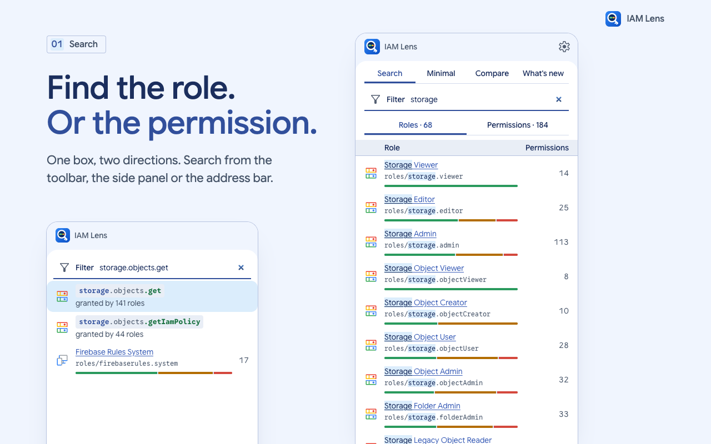
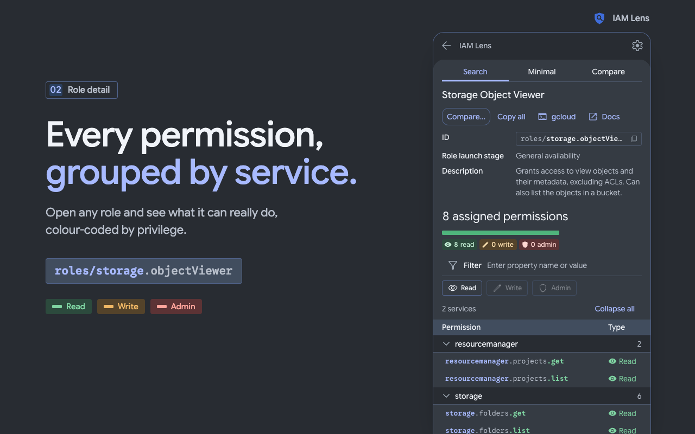
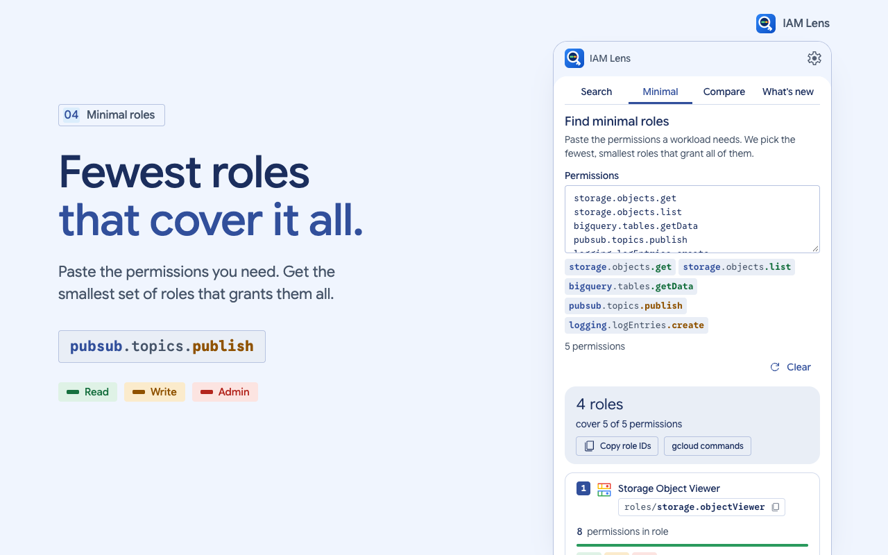
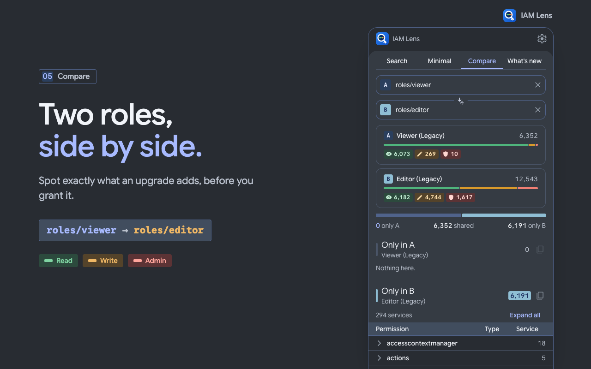

<p align="center">
  
</p>

<h1 align="center">IAM Lens</h1>

<p align="center">
  Look up Google Cloud IAM both ways: permission to roles, role to permissions, in one keystroke.
</p>

<p align="center">
  <a href="https://github.com/Ranger7899/IAM-Lens-extension/actions/workflows/ci.yml"></a>
  <a href="LICENSE"></a>
  <!-- TODO: add the Chrome Web Store badge once the listing is live:
  <a href="CHROME_WEB_STORE_URL"></a> -->
</p>

<p align="center">
  <a href="https://iamlens.vaultline.cloud/">Homepage</a> ·
  <a href="https://iamlens.vaultline.cloud/privacy.html">Privacy policy</a> ·
  <a href="https://iamlens.vaultline.cloud/terms.html">Terms</a>
</p>

<p align="center">
  
  
</p>

IAM Lens is a Chrome (Manifest V3) extension for people who write and review Google Cloud IAM policies. Paste a permission such as `storage.objects.get` and see every role that grants it. Open a role and see every permission it holds. It works offline on a bundled snapshot of the predefined roles.

## Features

- **Two-way lookup.** Permission to roles, role to permissions, with fast fuzzy search.
- **Least-privilege hints.** Roles are ordered smallest first, and broad roles are flagged so you can pick the tightest fit.
- **Minimal-role finder and Compare.** Optional side-panel tabs (off by default, switch them on in Settings). Paste several permissions to get a small set of roles that covers them, or compare two roles side by side.
- **Custom roles.** Optional sign-in finds every project and organization your account can access and adds their custom roles to search. It re-syncs automatically.
- **Quick access.** Type `iam <query>` in the address bar (omnibox), or right-click selected text and choose "Look up in IAM Lens". Popup, side panel and options page are included.
- **Offline.** A bundled snapshot of about 2,400 predefined roles and 14,000 permissions is available immediately and refreshes in the background.

| Minimal roles | Compare |
| --- | --- |
|  |  |

## Privacy by design

- No analytics, no tracking, no remote code.
- Sign-in is optional. When you use it, the extension calls `chrome.identity.getAuthToken` (Chrome only) and makes **read-only GET** requests to list projects, organizations and their custom roles.
- Everything it reads is stored **locally** in your browser. Nothing is sent to the developer.
- Signing out **revokes the token** and deletes the locally stored custom roles.

Full policy: <https://iamlens.vaultline.cloud/privacy.html>

## Install

- **Chrome Web Store:** link coming soon. <!-- TODO: add the store URL once the listing is live. -->
- **Load unpacked from a release zip:**
  1. Download the extension zip from the repository's Releases page and unzip it.
  2. Open `chrome://extensions` and turn on Developer mode.
  3. Choose "Load unpacked" and select the unzipped folder.

Note: sign-in for custom roles uses `chrome.identity.getAuthToken`, which needs Google Chrome with a signed-in profile. Lookup works without signing in.

## Development

Prerequisites: Node 26 (the version CI uses, see [`.github/workflows/ci.yml`](.github/workflows/ci.yml)) and npm.

```sh
npm ci                      # install dependencies
npm run dev                 # WXT dev server, opens Chrome with the extension (HMR)
npm run build               # production build to .output/chrome-mv3
npm test                    # unit tests (Vitest + WXT fake-browser)
npx playwright install chromium   # first time only
npx playwright test         # end-to-end tests (run npm run build first)
npm run zip                 # packaged zip
```

Also available: `npm run lint`, `npm run typecheck`, `npm run format`.

To load a local build: `chrome://extensions` > Developer mode > Load unpacked > `.output/chrome-mv3`.

The predefined-roles snapshot in `data/` is generated by `scripts/build-snapshot.ts` from the public IAM API (`roles.list`). See [`docs/snapshot-pipeline.md`](docs/snapshot-pipeline.md) for running it locally and for the nightly pipeline setup. Design notes live in [`docs/design.md`](docs/design.md).

## Architecture

```
src/
  core/         data model, snapshot loading, search, least-privilege and diff logic
  ui/           React 19 UI: M3 components, screens, theme tokens, settings
  entrypoints/  popup, sidepanel, options pages
  background/   service worker: omnibox, context menu, snapshot and custom-role refresh
scripts/        snapshot builder, theme/icon generators, bundle check
data/           generated roles snapshot and manifest
docs/           design, store listing, pipeline and release docs
```

Data flow: a nightly GitHub Actions workflow authenticates to Google Cloud with Workload Identity Federation (no stored keys), builds the snapshot with `scripts/build-snapshot.ts`, and publishes it to GitHub Pages. The extension ships with a bundled copy and refreshes from Pages in the background. Custom roles, if you sign in, are fetched straight from Google APIs into local storage.

Stack: WXT, TypeScript (strict), React 19, MiniSearch, IndexedDB (`idb`), Vitest, Playwright.

## Contributing

Contributions are welcome. Please read [CONTRIBUTING.md](CONTRIBUTING.md) and the [Code of Conduct](CODE_OF_CONDUCT.md) first. Report vulnerabilities as described in [SECURITY.md](SECURITY.md).

## License

Released under the [MIT License](LICENSE). Third-party notices (fonts, icons and other bundled assets) are in [NOTICE.md](NOTICE.md).

## Disclaimer

IAM Lens is an independent project. It is not affiliated with, endorsed by, or sponsored by Google. Google Cloud and Chrome are trademarks of Google LLC.
