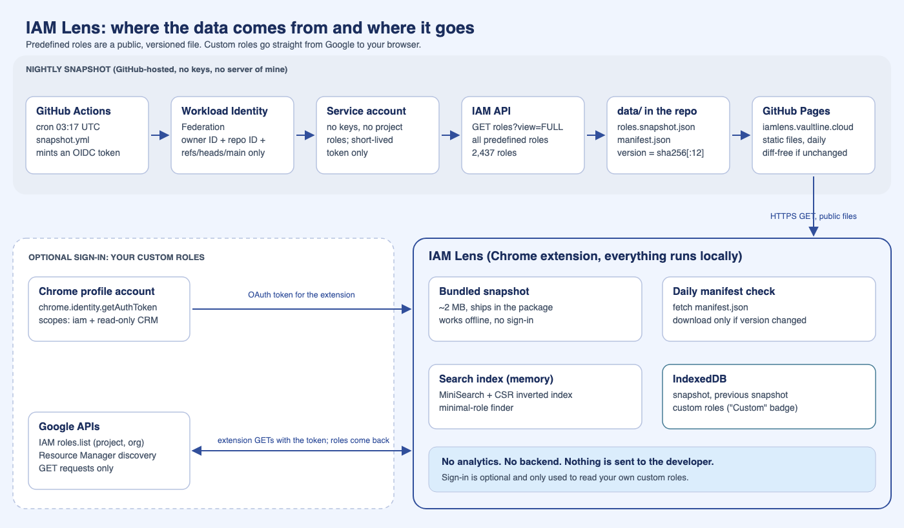
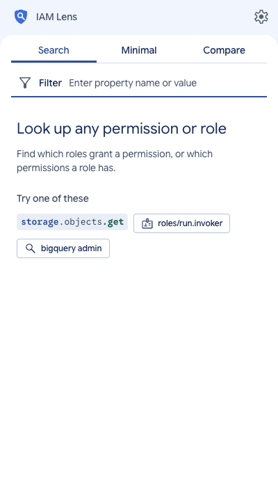
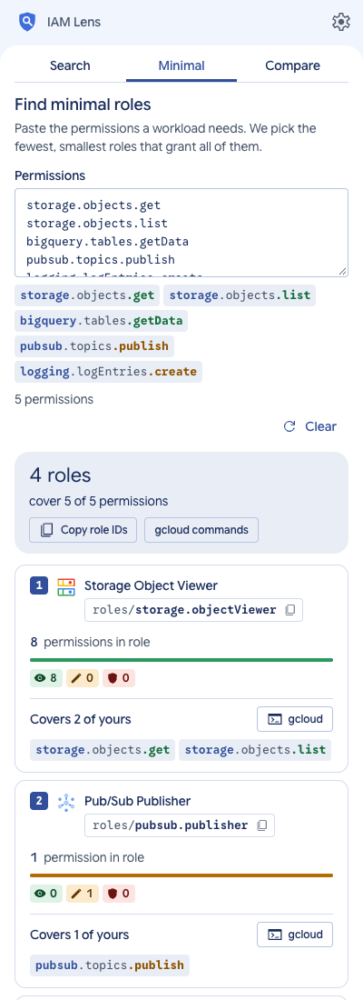
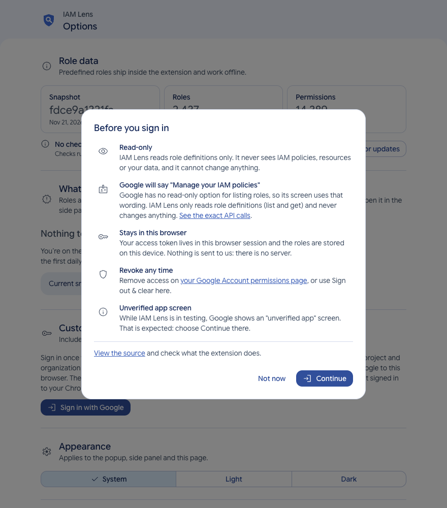

# How I built a GCP IAM lookup extension that never sends your data anywhere

*Privacy as an architecture decision, not a policy.*

Every GCP engineer has asked "which role grants `compute.instances.setMetadata`?" and then lost five minutes to it.

The IAM docs have a roles reference, but it is one long page per service, and the permission-to-role direction is awkward. `gcloud iam roles list` plus grep works, but it is slow and needs a login. Policy Troubleshooter and the Console's role picker answer "why was this denied?" for a specific principal and resource. They do not answer "what is the smallest role that covers these ten permissions?".

I wanted a search box that answered both directions instantly, worked on a plane, and did not ask me to trust yet another server with my project list. So I built one: IAM Lens, a Chrome extension. This post covers the design, the data pipeline behind it, and what Google's OAuth verification taught me about the cost of even one sensitive scope.



## The problem

There are two questions, and they point in opposite directions. "Which roles grant this permission?" goes from a permission to roles. "What does this role let me do?" goes from a role to permissions. The docs are organised for the second one. `gcloud` can do both, but only with a login and a lot of output to filter. Policy Troubleshooter is excellent, but it works on a concrete principal and resource, not on a bare permission list from a Terraform diff.

This matters because of how least privilege fails in practice. People grant `roles/editor` not because they want to, but because finding the right narrow role is tedious. If the lookup takes five minutes, the broad role wins.

I made it a browser extension because the lookup happens next to something else: a Console tab, a pull request, a failing deployment. It should be one click away, not a context switch.

## Design goals: instant, offline, private

I set three goals and wrote them down as constraints I could test.

**Instant.** The budgets are 150 ms for the panel to become interactive and 16 ms per keystroke to render results. Both are enforced in an end-to-end Playwright test (`e2e/perf.spec.ts`), with some slack: 1.25x for panel-ready, 1.5x for keystrokes. Each measurement is sampled five times, and keystrokes are sampled twenty times. The budgets are enforced on my machine and only reported on shared CI, where timings are too noisy to gate on.

**Offline.** The whole predefined-role catalogue ships inside the extension, so search works with no network and no sign-in.

**Private.** No analytics and no backend. Sign-in is optional and only used to read your own custom roles.

These goals have a cost. The extension carries a data file of about 2 MB, and I needed a way to refresh it that does not involve running a server. The next section is how I solved that.

## The data: a nightly snapshot with Workload Identity Federation

A GitHub Actions workflow runs daily at 03:17 UTC. It calls the IAM API once, paginated:

```
GET iam.googleapis.com/v1/roles?view=FULL&pageSize=1000
```

and writes two files: `roles.snapshot.json` and `manifest.json`. The current snapshot has 2,437 predefined roles and 14,389 distinct permissions.

The workflow authenticates with Workload Identity Federation, so no service account key exists anywhere. GitHub's OIDC token is exchanged for a short-lived service-account token. I tightened the setup in three ways. Impersonation is limited to one numeric repository ID. The provider has a condition on the numeric owner ID and on `refs/heads/main`. And the service account has no project roles at all, because listing predefined roles does not need any. Numeric IDs matter because names can be renamed and re-registered; IDs cannot.

The snapshot format is interned. Each permission string is stored once, in a sorted list, and roles hold lists of indices into it. Roles reference permissions about 207,000 times in total, so storing each string once shrinks the JSON from about 8.1 MB to about 2.1 MB, roughly 4x, before gzip.

The version is the first 12 hex characters of a SHA-256 over the canonical content, with the `generatedAt` timestamp excluded. If Google has not changed any role, the hash does not change, the workflow produces no diff, and nothing is deployed. A daily cron that is silent on quiet days is exactly what I wanted.

The size is about 2.07 MB raw and about 0.47 MB gzipped. The extension fetches the small manifest daily and downloads the snapshot only when the version differs from what it already has. "What's new" in the UI is simply a diff of two snapshots.

## Search and least privilege

Search uses MiniSearch for fuzzy full-text matching over roles and permissions. Underneath, each role is a sorted `Int32Array` of permission indices, and a compressed-sparse-row inverted index maps each permission back to the roles that grant it. That is what makes the permission-to-role direction cheap.

Ranking mattered more than raw speed. The numerically smallest role granting a permission is often a service agent, meant for a Google-managed identity and not for a person. So results put roles of the permission's own service first, and demote service-agent, BETA, legacy and deprecated roles. This is the kind of thing a plain text match never gets right.

The minimal-role finder takes a pasted list of permissions and proposes a small set of roles. It is a greedy weighted set cover. At each step it picks the role with the best score:

```ts
// src/core/leastPrivilege.ts (trimmed)
// score = newly covered / (permission count + ROLE_OVERHEAD)
export const ROLE_OVERHEAD = 10;
```

The overhead term models the cost of one more binding. Without it, a one-permission legacy role always beats a slightly larger role that covers several of your targets. Candidates are processed in tiers: roles of the same service first, then any ordinary role, then service-agent roles, then deleted or deprecated ones, each tier only for what the earlier tiers could not cover. A final pass prunes redundant picks.

One honest caveat: greedy set cover is an approximation, not the optimum. It gives a sensible answer fast, and I would rather say that than imply it is provably minimal.

<!-- worked example: pick one real permission list and verify the output against the current snapshot before publishing -->





## Custom roles without a backend

Predefined roles are public. Custom roles are not, so they need sign-in. I used `chrome.identity.getAuthToken` with a Chrome Extension OAuth client. There is no redirect URI and no client secret, and it uses the account already signed in to the Chrome profile. Signing out revokes the token.

Every call is a GET. The extension lists custom roles on organizations and projects with `roles.list`, and it discovers which projects and organizations you can reach through Resource Manager. After one sign-in it syncs everything accessible: when you open the panel and the data is older than an hour, then hourly after that, or on demand.

The roles go into IndexedDB in the browser and are merged into the same search index with a "Custom" badge. Nothing is uploaded anywhere.



Why not a backend? A backend would have to hold either your tokens or your role data. Leaving it out does not just reduce work for me. It removes the question of whether you should trust it.

## Getting verified by Google

Even a read-only extension needs OAuth verification once it asks for a sensitive scope, and I learned a few things the hard way.

**Scopes.** There is no read-only IAM scope. For custom `roles.list`, the only accepted scopes are `https://www.googleapis.com/auth/iam` and `cloud-platform`. I use `iam`. I add `cloud-platform.read-only` only for project discovery. A call to `roles.list` with `cloud-platform.read-only` alone returns 403 `ACCESS_TOKEN_SCOPE_INSUFFICIENT`, which I confirmed rather than assumed.

**Branding.** You need a homepage on a domain you own and have verified in Search Console. A `github.io` host is likely to be rejected. You need a privacy policy on the same domain, and a demo video that shows the whole consent flow.

**The redirect domain.** I started with `launchWebAuthFlow`, but its `chromiumapp.org` redirect domain cannot be verified. Switching to `getAuthToken` with a Chrome Extension client type solved that, and removed the redirect URI altogether. The trade-off is that it works in Chrome only.

Google's stated timelines are about 10 business days for a sensitive scope and 2 to 3 days for brand verification. Until it is approved, an unverified app is capped at 100 new users for its lifetime.

<!-- update after IAM-57: replace this paragraph with the real verification outcome and timeline -->

## Lessons learned

- **Ship the data, not a server.** A bundled snapshot removes whole classes of operations, privacy and cost problems.
- **Content-hash versions make a daily cron safe and quiet.** No change means no commit and no deploy.
- **Budgets in tests keep "instant" true.** A performance number that nobody enforces drifts. Mine is a failing test.
- **Scope minimisation is a product decision** as much as a compliance one. Choosing fewer scopes changed what the extension could do, and I had to be at peace with that.
- **Ranking quality beat search speed.** Demoting service agents and legacy roles did more for the usefulness of results than any performance work.

The limits are real. It is Chrome only, the set cover is greedy, and the snapshot is only as fresh as the last nightly run.

## Try it and contribute

IAM Lens is open source under the MIT license.

- Homepage: [https://iamlens.vaultline.cloud/](https://iamlens.vaultline.cloud/)
- Chrome Web Store: <STORE_URL>
- Source: [https://github.com/Ranger7899/IAM-Lens-extension](https://github.com/Ranger7899/IAM-Lens-extension)

If you find a missing role, a wrong ranking, or have an idea for the minimal-role finder, please open an issue. I would especially like to hear about permission lists where the suggestion looks wrong.

*IAM Lens is an independent project and is not affiliated with Google. Google Cloud and IAM are trademarks of Google LLC.*

*Yousef Masad*
